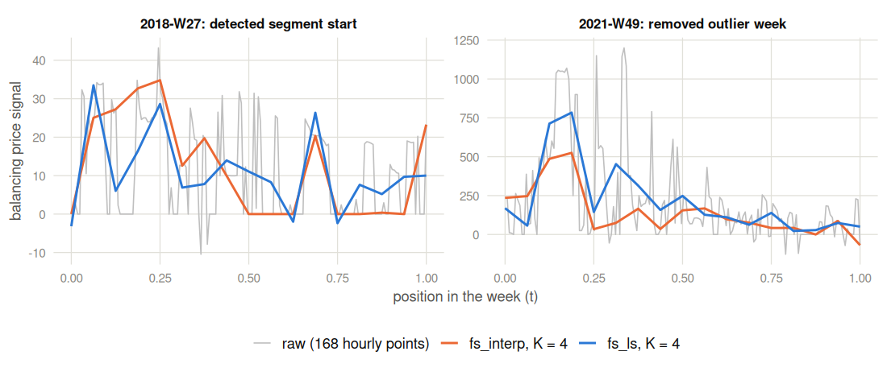
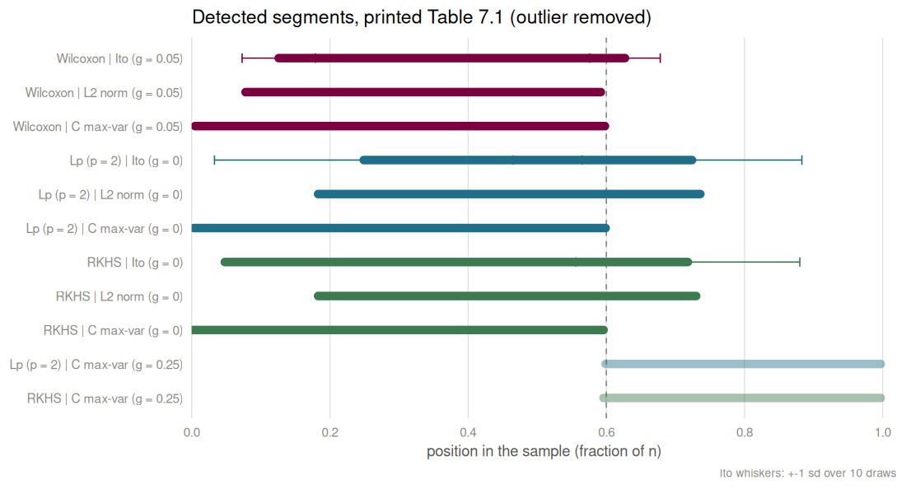
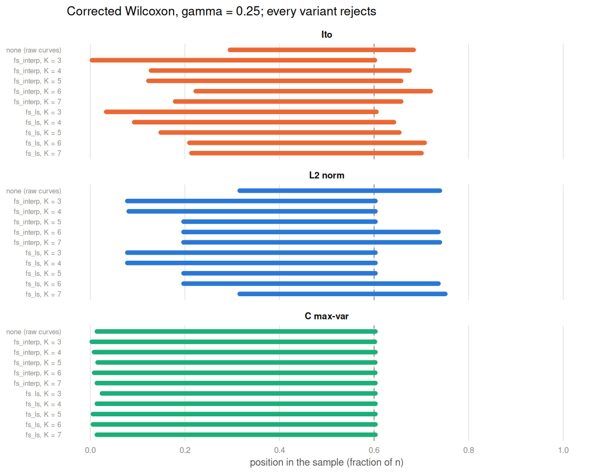
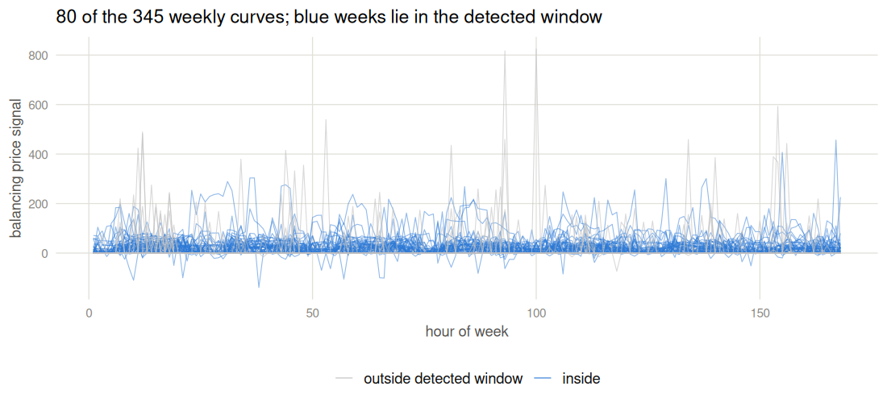
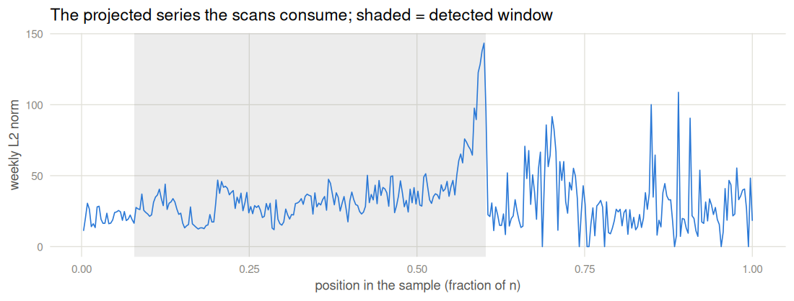

The LITGRID application, visualized
================

- [The data in numbers](#the-data-in-numbers)
- [What the curves look like](#what-the-curves-look-like)
- [The corrected result tables](#the-corrected-result-tables)
- [Interval agreement across tests](#interval-agreement-across-tests)
- [Smoothing moves localisation, not
  detection](#smoothing-moves-localisation-not-detection)
- [The full sample, live](#the-full-sample-live)

The dissertation’s application scans weekly Lithuanian electricity
balancing-price curves: one curve per week, 168 hourly points, built
from the public exports of the [Baltic transparency
dashboard](https://baltic.transparency-dashboard.eu/). Everything below
except the last section renders from committed CSVs in
`reproduction/data/`; the full-curve sections at the end additionally
need the raw exports, fetched and checksum-verified by
`applications/litgrid/download_litgrid.R` (raw data present at render
time: TRUE).

One distinction runs through all of it: the **legacy pipeline**
reproduces the printed tables including their data quirks (summed export
overlaps, boundary-week mislabelling), while the **fixed pipeline**
deduplicates and orders weeks chronologically. Both are computed by
`applications/litgrid/corrected_tables.R`; the fixed no-outlier sample
has n = 345 weeks. The audit-corrected statistics are used throughout.

## The data in numbers

`data/litgrid_tail_stats.csv` (built by
`aggregators/litgrid_tail_stats.R`) summarizes the analysed hourly
series against the deduplicated raw one:

``` r
ts <- read.csv(file.path(DATA, "litgrid_tail_stats.csv"))
knitr::kable(ts, digits = 3)
```

| statistic            |  analysed | dedup_raw |
|:---------------------|----------:|----------:|
| n_hours              | 57792.000 | 59153.000 |
| zero_share           |     0.563 |     0.567 |
| mean                 |    17.579 |    16.041 |
| sd                   |    37.934 |    39.710 |
| median               |     0.000 |     0.000 |
| iqr                  |    23.840 |    20.940 |
| skewness             |     5.826 |     9.546 |
| excess_kurtosis      |    78.579 |   180.411 |
| q0.1pct              |   -30.697 |   -30.413 |
| q1pct                |    -0.320 |    -0.260 |
| q25pct               |     0.000 |     0.000 |
| q75pct               |    23.840 |    20.940 |
| q99pct               |   173.287 |   166.698 |
| q99.9pct             |   386.232 |   442.924 |
| min                  |  -324.920 |  -227.430 |
| max                  |  1257.590 |  1257.590 |
| over4sd_hours        |   619.000 |   547.000 |
| over4sd_gauss_expect |     3.661 |     3.747 |
| over6sd_hours        |   204.000 |   204.000 |
| over6sd_gauss_expect |     0.000 |     0.000 |
| hill_alpha_k2.5pct   |     2.546 |     1.824 |
| hill_alpha_k5pct     |     2.038 |     1.922 |
| spike_thr_abs        |   218.804 |   223.995 |
| spike_episodes       |   254.000 |   239.000 |
| spike_len_median_h   |     1.000 |     1.000 |
| spike_len_max_h      |     6.000 |    19.000 |
| diff_excess_kurtosis |   100.817 |   128.083 |
| max_abs_hourly_jump  |  1257.590 |  1257.590 |

## What the curves look like

`data/smoothing_example_curves.csv` carries two real weeks sampled from
the analysis (the detected segment’s first week and the removed outlier
week), raw and after the two Faber-Schauder reconstructions the
dissertation’s preprocessing uses. The reconstruction chapter’s
conclusion in one picture: level K = 4 keeps the shape while flattening
hour-level noise.

``` r
# keep the two real weeks; the file's synthetic f_alpha rows carry an
# unquoted comma in their role field and would shift the columns
lines_raw <- readLines(file.path(DATA, "smoothing_example_curves.csv"))
keep <- grepl("^(label|201827|202149),", lines_raw)
sm <- read.csv(text = paste(lines_raw[keep], collapse = "\n"))
sm$series_lab <- factor(sm$series, c("raw", "fs_interp", "fs_ls"),
                        c("raw (168 hourly points)", "fs_interp, K = 4",
                          "fs_ls, K = 4"))
sm$week_lab <- factor(sm$label, c("201827", "202149"),
                      c("2018-W27: detected segment start",
                        "2021-W49: removed outlier week"))
ggplot(sm, aes(t, value, colour = series_lab, linewidth = series_lab)) +
  geom_line() +
  facet_wrap(~ week_lab, scales = "free_y") +
  scale_colour_manual(values = c(COL_PLAIN, COL4, COL1), name = NULL) +
  scale_linewidth_manual(values = c(0.5, 0.9, 0.9), name = NULL) +
  labs(x = "position in the week (t)", y = "balancing price signal") +
  theme_nb
```

<!-- -->

## The corrected result tables

`data/litgrid_corrected_tables.csv` recomputes the full printed grid
with the corrected statistics, on both pipelines and both samples. The
fixed no-outlier rows are the headline: every method rejects at every
considered gamma, and the detected windows share the right endpoint near
60% of the sample, the energy-crisis period the application chapter
discusses.

``` r
ct <- read.csv(file.path(DATA, "litgrid_corrected_tables.csv"))
fixed <- subset(ct, pipeline == "fixed" & sample == "no_outlier",
                select = c(method, projection, gamma, stat, cv,
                           lo, hi, week_lo, week_hi))
fixed$window <- sprintf("[%.3f, %.3f]", fixed$lo, fixed$hi)
fixed$weeks  <- sprintf("%s to %s", fixed$week_lo, fixed$week_hi)
knitr::kable(fixed[c("method", "projection", "gamma", "stat", "cv",
                     "window", "weeks")],
             digits = 2, row.names = FALSE,
             caption = "Fixed pipeline, outlier removed, n = 345. Ito rows: mean over 10 shared paths.")
```

| method   | projection | gamma |  stat |   cv | window           | weeks            |
|:---------|:-----------|------:|------:|-----:|:-----------------|:-----------------|
| wilcoxon | l2         |  0.05 |  6.30 | 1.87 | \[0.078, 0.603\] | 201827 to 202152 |
| wilcoxon | l2         |  0.25 |  8.32 | 2.54 | \[0.078, 0.603\] | 201827 to 202152 |
| wilcoxon | l2         |  0.45 | 10.98 | 3.85 | \[0.078, 0.603\] | 201827 to 202152 |
| lp       | l2         |  0.00 |  1.88 | 0.54 | \[0.078, 0.603\] | 201827 to 202152 |
| lp       | l2         |  0.25 |  2.30 | 0.68 | \[0.197, 0.603\] | 201916 to 202152 |
| lp       | l2         |  0.45 |  2.78 | 1.08 | \[0.316, 0.603\] | 202005 to 202152 |
| rkhs     | l2         |  0.00 |  3.20 | 1.03 | \[0.197, 0.603\] | 201916 to 202152 |
| rkhs     | l2         |  0.25 |  4.10 | 1.48 | \[0.423, 0.603\] | 202042 to 202152 |
| rkhs     | l2         |  0.45 |  6.36 | 2.81 | \[0.557, 0.603\] | 202135 to 202152 |
| wilcoxon | c_max_var  |  0.05 |  7.41 | 1.87 | \[0.003, 0.603\] | 201801 to 202152 |
| wilcoxon | c_max_var  |  0.25 |  9.86 | 2.54 | \[0.003, 0.603\] | 201801 to 202152 |
| wilcoxon | c_max_var  |  0.45 | 13.11 | 3.85 | \[0.003, 0.603\] | 201801 to 202152 |
| lp       | c_max_var  |  0.00 |  2.28 | 0.54 | \[0.003, 0.603\] | 201801 to 202152 |
| lp       | c_max_var  |  0.25 |  2.85 | 0.68 | \[0.603, 1.000\] | 202152 to 202433 |
| lp       | c_max_var  |  0.45 |  3.43 | 1.08 | \[0.603, 1.000\] | 202152 to 202433 |
| rkhs     | c_max_var  |  0.00 |  3.46 | 0.83 | \[0.603, 1.000\] | 202152 to 202433 |
| rkhs     | c_max_var  |  0.25 |  4.36 | 1.14 | \[0.603, 1.000\] | 202152 to 202433 |
| rkhs     | c_max_var  |  0.45 |  5.25 | 1.77 | \[0.603, 1.000\] | 202152 to 202433 |
| wilcoxon | ito        |  0.05 |  5.04 | 1.87 | \[0.092, 0.642\] | 201832 to 202214 |
| wilcoxon | ito        |  0.25 |  6.73 | 2.54 | \[0.093, 0.642\] | 201832 to 202214 |
| wilcoxon | ito        |  0.45 |  8.99 | 3.85 | \[0.089, 0.642\] | 201831 to 202214 |
| lp       | ito        |  0.00 |  1.47 | 0.54 | \[0.143, 0.655\] | 201850 to 202218 |
| lp       | ito        |  0.25 |  1.87 | 0.68 | \[0.512, 0.839\] | 202120 to 202330 |
| lp       | ito        |  0.45 |  2.34 | 1.08 | \[0.439, 0.723\] | 202047 to 202241 |
| rkhs     | ito        |  0.00 |  2.26 | 0.83 | \[0.494, 0.893\] | 202114 to 202348 |
| rkhs     | ito        |  0.25 |  2.88 | 1.14 | \[0.463, 0.801\] | 202103 to 202316 |
| rkhs     | ito        |  0.45 |  3.62 | 1.77 | \[0.461, 0.723\] | 202102 to 202241 |

Fixed pipeline, outlier removed, n = 345. Ito rows: mean over 10 shared
paths.

Rejection is universal here (`stat > cv` in every row); the same table’s
legacy-pipeline rows document how the printed values arise, including
the printed Wilcoxon statistics that *decrease* in gamma because the
legacy implementation divided by the weight it should multiply by.

## Interval agreement across tests

The dissertation’s Table 7.1 (outlier removed) reports one detected
segment per test and projection; `data/litgrid_intervals.csv`
transcribes it, and the picture shows the agreement: whatever the test
and whatever the projection, the right endpoint lands near the 60% mark.
The lighter bars are the complementary window that the C max-var rows
flag at gamma = 0.25, the same break seen from the right.

``` r
d <- read.csv(file.path(DATA, "litgrid_intervals.csv"))
TEST_COLS <- c(wilcoxon = "#7b003f", lp = "#1f6f8b", rkhs = "#3d7a4f")
TEST_LABS <- c(wilcoxon = "Wilcoxon", lp = "Lp (p = 2)", rkhs = "RKHS")
PROJ_LABS <- c(ito = "Ito", l2 = "L2 norm", c_max_var = "C max-var")
loc <- rbind(d[d$test == "wilcoxon" & d$gamma == 0.05, ],
             d[d$test == "lp" & d$gamma == 0, ],
             d[d$test == "rkhs" & d$gamma == 0, ])
loc$alpha_v <- 1
loc$glab <- ifelse(loc$test == "wilcoxon", "g = 0.05", "g = 0")
comp <- d[d$projection == "c_max_var" & d$gamma == 0.25 &
          d$test %in% c("lp", "rkhs"), ]
comp$alpha_v <- 0.45
comp$glab <- "g = 0.25"
pd <- rbind(loc, comp)
pd$row_lab <- sprintf("%s | %s (%s)", TEST_LABS[pd$test],
                      PROJ_LABS[pd$projection], pd$glab)
pd$row_lab <- factor(pd$row_lab, levels = rev(unique(pd$row_lab)))
ggplot(pd, aes(y = row_lab, colour = test)) +
  geom_vline(xintercept = 0.60, linetype = "dashed", colour = INK_MUTED) +
  geom_segment(aes(x = l_lo, xend = l_hi, yend = row_lab, alpha = alpha_v),
               linewidth = 3.2, lineend = "round") +
  geom_errorbarh(aes(xmin = l_lo - l_lo_sd, xmax = l_lo + l_lo_sd),
                 height = 0.28, linewidth = 0.5, na.rm = TRUE) +
  geom_errorbarh(aes(xmin = l_hi - l_hi_sd, xmax = l_hi + l_hi_sd),
                 height = 0.28, linewidth = 0.5, na.rm = TRUE) +
  scale_colour_manual(values = TEST_COLS, guide = "none") +
  scale_alpha_identity() +
  scale_x_continuous(limits = c(0, 1.02), breaks = seq(0, 1, 0.2),
                     expand = c(0, 0)) +
  labs(x = "position in the sample (fraction of n)", y = NULL,
       subtitle = "Detected segments, printed Table 7.1 (outlier removed)",
       caption = "Ito whiskers: +-1 sd over 10 draws") +
  theme_nb + theme(panel.grid.major.y = element_blank(),
                   plot.caption = element_text(colour = INK_MUTED, size = 9))
```

<!-- -->

## Smoothing moves localisation, not detection

`data/smoothing_sensitivity.csv` (built by
`aggregators/smoothing_sensitivity.R`) reruns the corrected Wilcoxon
application over reconstruction variants. Detection is stable: every
variant rejects. Localisation is what moves, mostly the left endpoint of
the detected window.

``` r
ss <- read.csv(file.path(DATA, "smoothing_sensitivity.csv"))
app <- subset(ss, arm == "application" & gamma == 0.25 &
              (grid != "input" | method == "none"))
app <- app[order(app$method != "none", app$method, app$K), ]
app$recon_lab <- ifelse(app$method == "none", "none (raw curves)",
                        sprintf("%s, K = %d", app$method, app$K))
app$recon_lab <- factor(app$recon_lab, rev(unique(app$recon_lab)))
app$proj_lab <- factor(PROJ_LABS[app$projection], PROJ_LABS)
ggplot(app, aes(y = recon_lab)) +
  geom_vline(xintercept = 0.60, linetype = "dashed", colour = INK_MUTED) +
  geom_segment(aes(x = lo, xend = hi, yend = recon_lab, colour = proj_lab),
               linewidth = 2.6, lineend = "round") +
  facet_wrap(~ proj_lab, ncol = 1) +
  scale_colour_manual(values = c(COL4, COL1, COL2), guide = "none") +
  scale_x_continuous(limits = c(0, 1), breaks = seq(0, 1, 0.2)) +
  labs(x = "position in the sample (fraction of n)", y = NULL,
       subtitle = "Corrected Wilcoxon, gamma = 0.25; every variant rejects") +
  theme_nb + theme(panel.grid.major.y = element_blank(),
                   axis.text.y = element_text(size = 8.5))
```

<!-- -->

## The full sample, live

The rest needs the raw exports. Fetch them once with

``` sh
Rscript reproduction/applications/litgrid/download_litgrid.R
```

and re-render; with `has_raw = FALSE` the chunks below are skipped.

``` r
source(file.path("..", "applications", "litgrid", "data.R"))
m <- suppressWarnings(load_litgrid_balancing_prices(
  RAW, dedup_exports = TRUE, fix_week_labels = TRUE, stamp = "from"))
lab <- as.integer(rownames(m))
m <- m[lab <= SPAN_END & lab != OUTLIER_WEEK, , drop = FALSE]
X <- t(m)                                  # curves in columns, (168 x 345)
dim(X)
#> [1] 168 345
```

``` r
n <- ncol(X)
h <- seq_len(nrow(X))
win <- which(seq_len(n) / n > 0.078 & seq_len(n) / n <= 0.603)
show <- unique(round(seq(1, n, length.out = 80)))
df <- data.frame(
  hour = rep(h, length(show)), week = rep(show, each = nrow(X)),
  value = as.vector(X[, show]),
  inwin = rep(show %in% win, each = nrow(X)))
ggplot(df, aes(hour, value, group = week,
               colour = inwin, alpha = inwin)) +
  geom_line(linewidth = 0.35) +
  scale_colour_manual(values = c(`FALSE` = COL_PLAIN, `TRUE` = COL1),
                      labels = c("outside detected window", "inside"),
                      name = NULL) +
  scale_alpha_manual(values = c(`FALSE` = 0.6, `TRUE` = 0.5), guide = "none") +
  labs(x = "hour of week", y = "balancing price signal",
       subtitle = "80 of the 345 weekly curves; blue weeks lie in the detected window") +
  theme_nb
```

<!-- -->

``` r
wk <- data.frame(i = seq_len(n) / n, l2 = fdachange::project_l2(X))
ggplot(wk, aes(i, l2)) +
  annotate("rect", xmin = 0.078, xmax = 0.603, ymin = -Inf, ymax = Inf,
           fill = "grey50", alpha = 0.15) +
  geom_line(colour = COL1, linewidth = 0.5) +
  labs(x = "position in the sample (fraction of n)", y = "weekly L2 norm",
       subtitle = "The projected series the scans consume; shaded = detected window") +
  theme_nb
```

<!-- -->

The live test, exactly the fixed-pipeline analysis of the corrected
tables (Faber-Schauder least squares at K = 4, L2-norm projection,
corrected Wilcoxon scan), checked against the committed row:

``` r
library(fdachange)
Xr <- reconstruct(X, "fs_ls", K = 4, grid = "vertices")$X
ht <- epidemic_test(project_l2(Xr), "wilcoxon", gamma = 0.25, kernel = "h_0")
ht
#> 
#>  Epidemic change scan test (Wilcoxon-type antisymmetric kernel)
#> 
#> data:  project_l2(Xr)
#> T = 8.3206, gamma = 0.25, p-value < 2.2e-16
#> alternative hypothesis: an epidemic (changed then restored) segment
#> 
#> critical value (alpha = 0.05): 2.5379  [30000 null draws]
#> detected window: observations 28..208 (fractions 0.078..0.603)
row <- subset(ct, pipeline == "fixed" & sample == "no_outlier" &
              method == "wilcoxon" & projection == "l2" & gamma == 0.25)
cat(sprintf("committed row: stat %.6f, window [%.4f, %.4f] (%s..%s)\n",
            row$stat, row$lo, row$hi, row$week_lo, row$week_hi))
#> committed row: stat 8.320598, window [0.0783, 0.6029] (201827..202152)
stopifnot(isTRUE(all.equal(unname(ht$statistic), row$stat, tolerance = 1e-8)),
          isTRUE(all.equal(ht$m / ncol(Xr), row$hi, tolerance = 1e-8)))
cat("live run matches the committed table row\n")
#> live run matches the committed table row
```
