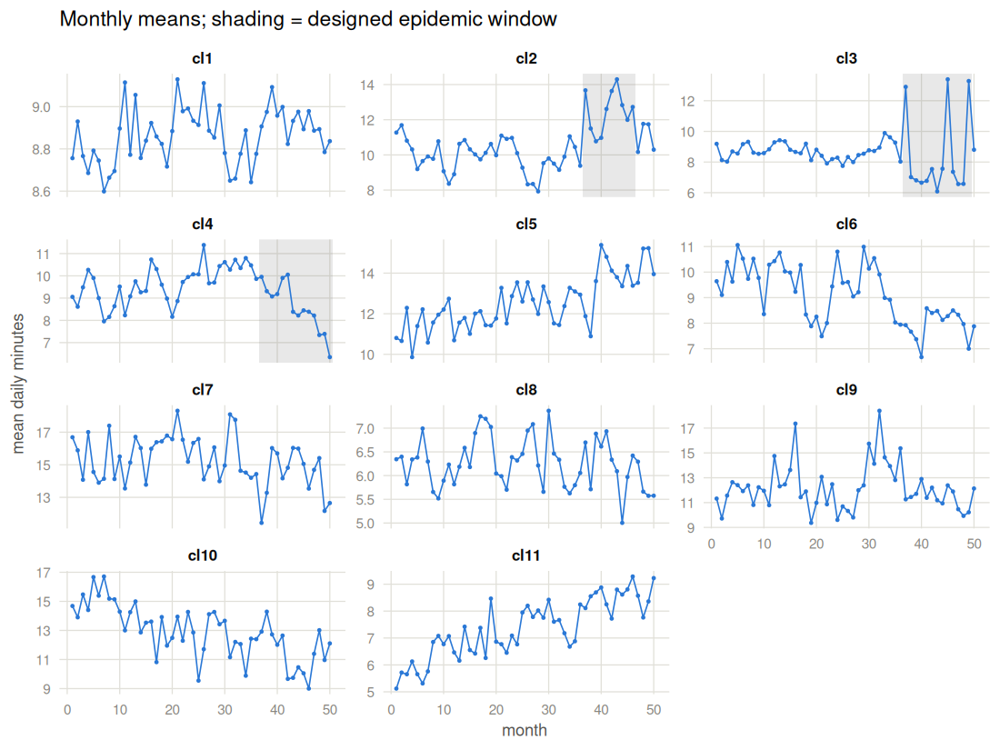
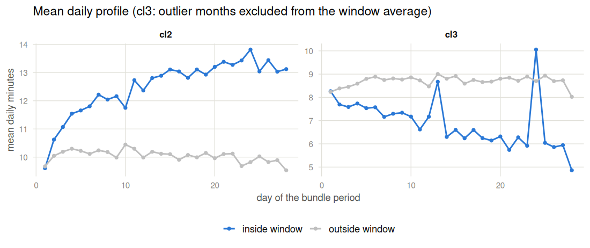

The telco application, visualized
================

- [The eleven clusters at a glance](#the-eleven-clusters-at-a-glance)
- [Inside vs outside the window, day
  level](#inside-vs-outside-the-window-day-level)
- [Scanning all eleven clusters](#scanning-all-eleven-clusters)
- [Exact calibration under FAR(1)
  dependence](#exact-calibration-under-far1-dependence)
- [Where the Python side mirrors
  this](#where-the-python-side-mirrors-this)

`fdachange::telco_far1` ships simulated daily voice-usage curves for 11
customer clusters, 50 months x 28 days each, following a functional
autoregressive FAR(1) process with month-to-month dependence
`beta(t) = 0.7 * sqrt(t)`. The model parameters were fitted on
aggregates of a real telco bundle-consumption sample and the generator
is fully committed (`data-raw/telco_far1.R`), so unlike the LITGRID
application the ground truth is known exactly. Clusters `cl2` to `cl4`
contain a designed epidemic change; `cl1` is a clean null; `cl5` to
`cl11` violate the null in *other* ways (trends, level shifts,
outliers), which is exactly what makes them useful: they show what a
changed-segment scan does when the data departs from H0 without
containing an epidemic change. See `?telco_far1` for the full design
table.

## The eleven clusters at a glance

One point per month (the monthly mean of the 28 daily values); the
shaded band is the designed change window where one exists.

``` r
telco <- telco_far1
ov <- do.call(rbind, lapply(names(telco), function(nm) {
  data.frame(cluster = nm, month = 1:50, mean = rowMeans(telco[[nm]]))
}))
windows <- do.call(rbind, lapply(names(telco), function(nm) {
  cm <- attr(telco[[nm]], "change_months")
  if (!length(cm)) return(NULL)
  data.frame(cluster = nm, lo = min(cm) - 0.5, hi = max(cm) + 0.5)
}))
ov$cluster <- factor(ov$cluster, names(telco))
windows$cluster <- factor(windows$cluster, names(telco))
ggplot(ov, aes(month, mean)) +
  geom_rect(data = windows, aes(xmin = lo, xmax = hi),
            ymin = -Inf, ymax = Inf, fill = "grey50", alpha = 0.18,
            inherit.aes = FALSE) +
  geom_line(colour = COL1, linewidth = 0.5) +
  geom_point(colour = COL1, size = 0.8) +
  facet_wrap(~ cluster, ncol = 3, scales = "free_y") +
  labs(x = "month", y = "mean daily minutes",
       subtitle = "Monthly means; shading = designed epidemic window") +
  theme_nb
```

<!-- -->

The designs read directly off the picture: the jumps in `cl2` (up),
`cl3` (down, with outlier months poking through) and `cl4` (deepening to
the sample end); the trends in `cl5`, `cl6`, `cl10`, `cl11`; the pure
level shifts in `cl7` and `cl8`; the outlier months in `cl9`.

## Inside vs outside the window, day level

The change is a `sqrt(t)`-shaped jump on the daily profile (as in
`generate_f4()`), so it grows through the month:

``` r
day <- do.call(rbind, lapply(c("cl2", "cl3"), function(nm) {
  Y <- telco[[nm]]
  cm <- attr(Y, "change_months")
  keep <- setdiff(cm, attr(Y, "outlier_months"))
  data.frame(cluster = nm, day = 1:28,
             inside  = colMeans(Y[keep, , drop = FALSE]),
             outside = colMeans(Y[-cm, , drop = FALSE]))
}))
dl <- reshape(day, direction = "long", varying = c("inside", "outside"),
              v.names = "mean", timevar = "where",
              times = c("inside window", "outside window"))
ggplot(dl, aes(day, mean, colour = where)) +
  geom_line(linewidth = 0.9) + geom_point(size = 1.6) +
  facet_wrap(~ cluster, scales = "free_y") +
  scale_colour_manual(values = c(`inside window` = COL1,
                                 `outside window` = COL_PLAIN), name = NULL) +
  labs(x = "day of the bundle period", y = "mean daily minutes",
       subtitle = "Mean daily profile (cl3: outlier months excluded from the window average)") +
  theme_nb
```

<!-- -->

## Scanning all eleven clusters

One month is one curve, so the scan sees 50 curves per cluster:
transpose to the package’s `(grid, n)` layout, project with the L2 norm,
and run the corrected Lp scan (gamma = 0.25). The shipped critical value
assumes independent observations; the last column previews the exact
FAR(1) calibration derived in the next section.

``` r
proj <- lapply(telco, function(Y) project_l2(t(Y)))
res <- do.call(rbind, lapply(names(telco), function(nm) {
  ht <- epidemic_test(proj[[nm]], "lp", gamma = GAMMA)
  cm <- attr(telco[[nm]], "change_months")
  data.frame(cluster = nm, T = round(unname(ht$statistic), 3),
             reject_iid = ht$statistic > ht$critical.value,
             window = sprintf("[%d, %d]", ht$k + 1, ht$m),
             designed = if (length(cm)) sprintf("%d..%d", min(cm), max(cm))
                        else "none")
}))
knitr::kable(res, row.names = FALSE,
             caption = sprintf("Corrected Lp scan, l2 projection, gamma = %s; iid critical value %.3f",
                               GAMMA, lp_critical_value(GAMMA)))
```

| cluster |     T | reject_iid | window     | designed |
|:--------|------:|:-----------|:-----------|:---------|
| cl1     | 0.670 | FALSE      | \[3, 9\]   | none     |
| cl2     | 0.948 | TRUE       | \[37, 49\] | 37..46   |
| cl3     | 0.764 | TRUE       | \[38, 48\] | 37..49   |
| cl4     | 0.956 | TRUE       | \[22, 37\] | 37..50   |
| cl5     | 1.028 | TRUE       | \[39, 50\] | none     |
| cl6     | 0.969 | TRUE       | \[35, 50\] | none     |
| cl7     | 0.678 | FALSE      | \[13, 25\] | none     |
| cl8     | 0.518 | FALSE      | \[14, 31\] | none     |
| cl9     | 0.723 | TRUE       | \[29, 36\] | none     |
| cl10    | 0.980 | TRUE       | \[1, 13\]  | none     |
| cl11    | 1.074 | TRUE       | \[1, 24\]  | none     |

Corrected Lp scan, l2 projection, gamma = 0.25; iid critical value 0.683

Reading it honestly, in four groups:

- `cl1` (clean null) is quiet, and the level-shift clusters `cl7`/`cl8`
  are too: a constant multiplier changes the level, not the distribution
  along the sample, so there is no segment to find.
- `cl2` and `cl3` are localized on their designed windows.
- `cl4` rejects, but its window is not meaningful: the designed jump
  deepens through the end of the sample, so the change never reverts and
  the alternative is one-sided rather than epidemic.
- The trend clusters (`cl5`, `cl6`, `cl10`, `cl11`) and the outlier
  cluster `cl9` also reject. That is not a failure of the test but a
  fact about scan statistics: they flag any sufficiently strong
  departure from “i.i.d. outside one window”, and a trend’s extreme end
  or a run of outlier months looks like a changed segment. Rejection
  alone never certifies that the change is epidemic; the localized
  window and the data must be inspected.

## Exact calibration under FAR(1) dependence

Months are serially dependent, while the shipped null caches assume
independent observations, so the sizes above are only approximate. The
generator is committed, which makes exact calibration cheap: simulate
the null from the same FAR(1) model (cl2’s fitted month- and day-level
sd from `data-raw/telco_far1.R`; the day profile taken as cl2’s mean
profile outside the designed window), push each draw through the same
projection-and-scan pipeline, and hand the draws to
`epidemic_test(null = )`.

``` r
mu <- colMeans(telco$cl2[-attr(telco$cl2, "change_months"), ])
sim_h0 <- function() {
  D <- 28L; n <- 50L
  t <- seq(0, 1, length.out = D)
  b <- 0.7 * sqrt(t)                 # far1_betas$beta1, the generator's beta
  s <- sqrt(1 - b^2)
  Z <- matrix(0, n, D); z <- numeric(D)
  for (j in seq_len(100L + n)) {     # 100 burn-in months, as in the generator
    z <- b * z + s * (rnorm(1, 0, S_LEVEL) + rnorm(D, 0, S_DAY))
    if (j > 100L) Z[j - 100L, ] <- z
  }
  pmax(sweep(Z, 2, mu, "+"), 0)
}
set.seed(NULL_SEED)
draws <- replicate(NULL_NREP, lp_statistic(project_l2(t(sim_h0())), GAMMA))
cat(sprintf("iid cache cv: %.3f   exact FAR(1) cv: %.3f\n",
            lp_critical_value(GAMMA), quantile(draws, 0.95)))
#> iid cache cv: 0.683   exact FAR(1) cv: 0.928
```

The dependence pushes the 95% critical value up by roughly a third, and
the verdicts tighten accordingly:

``` r
res$reject_far1 <- vapply(names(telco), function(nm) {
  ht <- epidemic_test(proj[[nm]], "lp", gamma = GAMMA, null = draws)
  ht$statistic > ht$critical.value
}, logical(1))
knitr::kable(res, row.names = FALSE,
             caption = "Same scans, iid vs exact FAR(1) calibration")
```

| cluster |     T | reject_iid | window     | designed | reject_far1 |
|:--------|------:|:-----------|:-----------|:---------|:------------|
| cl1     | 0.670 | FALSE      | \[3, 9\]   | none     | FALSE       |
| cl2     | 0.948 | TRUE       | \[37, 49\] | 37..46   | TRUE        |
| cl3     | 0.764 | TRUE       | \[38, 48\] | 37..49   | FALSE       |
| cl4     | 0.956 | TRUE       | \[22, 37\] | 37..50   | TRUE        |
| cl5     | 1.028 | TRUE       | \[39, 50\] | none     | TRUE        |
| cl6     | 0.969 | TRUE       | \[35, 50\] | none     | TRUE        |
| cl7     | 0.678 | FALSE      | \[13, 25\] | none     | FALSE       |
| cl8     | 0.518 | FALSE      | \[14, 31\] | none     | FALSE       |
| cl9     | 0.723 | TRUE       | \[29, 36\] | none     | FALSE       |
| cl10    | 0.980 | TRUE       | \[1, 13\]  | none     | TRUE        |
| cl11    | 1.074 | TRUE       | \[1, 24\]  | none     | TRUE        |

Same scans, iid vs exact FAR(1) calibration

`cl2` and `cl4` survive; `cl3`’s smaller jump no longer clears the exact
threshold at this gamma, and the outlier cluster `cl9` drops away, while
the strong trends exceed even the exact critical value. The general
lesson carries beyond this dataset: when observations are dependent,
calibrate against a null that models the dependence, or treat
iid-calibrated significance as optimistic. The same lesson applies to
the LITGRID application, where no generative model is available and the
reported sizes inherit the iid assumption.

## Where the Python side mirrors this

The pip package under `python/` ships the identical dataset
(`fdachange.load_telco_far1()`, bit-identical values) and its example
notebook (`python/examples/fdachange.ipynb`) walks the same application
with the same method choice; the statistics agree with this notebook’s
to numerical parity by the cross-language fixture suite.
